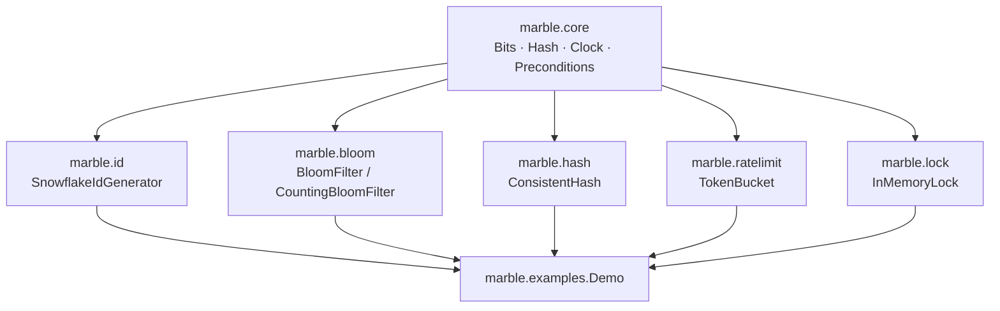

<div align="center">

# Marble

### 一套零依赖的 Java 分布式系统基础组件

[](https://github.com/WsNodeX/marble/stargazers)
[](https://github.com/WsNodeX/marble/releases)
[](LICENSE)

</div>

---

雪花 ID、布隆过滤器、一致性哈希、令牌桶、分布式锁 —— 五个在面试里反复出现、在架构里
无处不在、但大部分人只是"用过"的组件，用纯 JDK 标准库重写一遍。

每个组件几十到两三百行，自洽、可读、可测。

## 快速开始

```java
import marble.id.Snowflake;
import marble.id.SnowflakeIdGenerator;
import marble.bloom.BloomFilter;

// 趋势递增的分布式唯一 ID，可反解出时间戳 / 节点 / 序列号
SnowflakeIdGenerator idGen = new SnowflakeIdGenerator(Snowflake.classic(), 1);
long id = idGen.nextId();
System.out.println(idGen.decode(id));   // Components[timestamp=..., nodeId=1, sequence=0]

// 空间高效的概率判重，无假阴性
BloomFilter filter = new BloomFilter(1_000, 0.01);
filter.put("order-1001");
filter.mightContain("order-1001");      // true
filter.mightContain("order-9999");      // false（极大概率）
```

```bash
./build.sh                              # 编译 + 跑 Demo + 跑全部测试
java -cp build/main marble.examples.Demo
```

## 六个组件

| 组件 | 类型 | 关键方法 |
|---|---|---|
| 分布式 ID | `SnowflakeIdGenerator` | `nextId()` · `decode(long)` → `Components` |
| 布隆过滤器 | `BloomFilter` | `put` · `mightContain` · `merge` · `toBase64` / `fromBase64` |
| 计数布隆 | `CountingBloomFilter` | `put` · `remove` · `mightContain` |
| 一致性哈希 | `ConsistentHash<T>` | `addNode` · `removeNode` · `getNode(key)` |
| 令牌桶 | `TokenBucket` | `tryAcquire()` · `tryAcquire(int)` · `available()` |
| 分布式锁 | `InMemoryLock` | `tryLock(waitTime, unit)` → **返回 token** · `unlock(token)` · `isLocked()` |

**锁的 `unlock` 必须传回 `tryLock` 返回的那个 token** —— 这就是 Redis `SET NX` 那套里
"谁加的锁谁才能解"的所有权语义。原接口故意这么设计，换成 Redisson/etcd 后端时调用方式不变。

## 时间可注入

`SnowflakeIdGenerator`、`TokenBucket`、`InMemoryLock` 都接收一个 `Clock`。生产用系统时钟，
测试传 `Clock.ManualClock`，用 `advance(ms)` / `set(ms)` 精确拨动时间 —— 不靠
`Thread.sleep()` 凑覆盖率，毫秒级行为完全确定。

## 架构



每一层只依赖下一层，没有环依赖。`core` 是所有组件的共同底座。

## 安装

复制 `src/main/java/marble` 下需要的包进你的项目即可 —— 没有任何传递依赖，不需要
Maven/Gradle 配置。或用 `./build.sh` 编译后把 `build/main` 打成 jar。

## 测试

```bash
./build.sh        # 43 个 JUnit 5 用例
```

## 限制

- **`InMemoryLock` 是单机参考实现。** 它演示所有权与租约语义，但不能跨进程互斥。真做分布式
  锁要换 Redis/etcd 后端——接口已经对齐，实现要自己接。
- **`BloomFilter` 不支持删除。** 要删除用 `CountingBloomFilter`，代价是每个桶占 4 位。
- **没有基准数据。** 仓库里没有吞吐/内存实测，README 不编这类数字。

## 路线图

- [ ] `RedissonLock` / `EtcdLock` 作为 `DistributedLock` 的网络后端
- [ ] 一致性哈希的带权虚拟节点（异构机器权重）
- [ ] 滑动窗口 / 漏桶实现，与令牌桶做对比

## License

[MIT](LICENSE)
